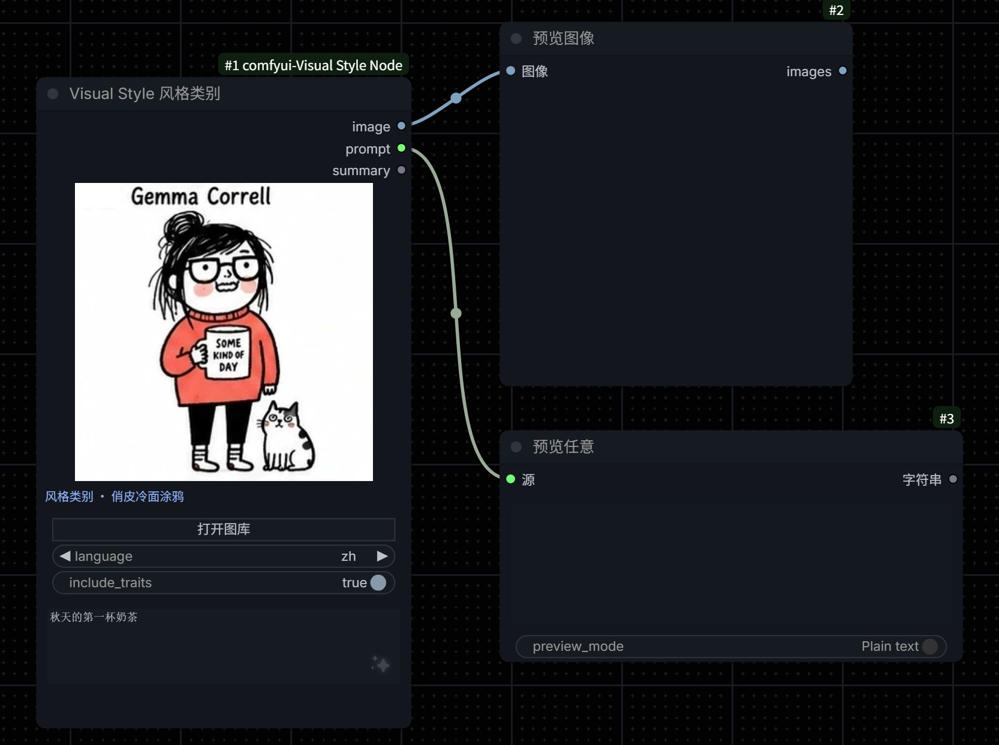
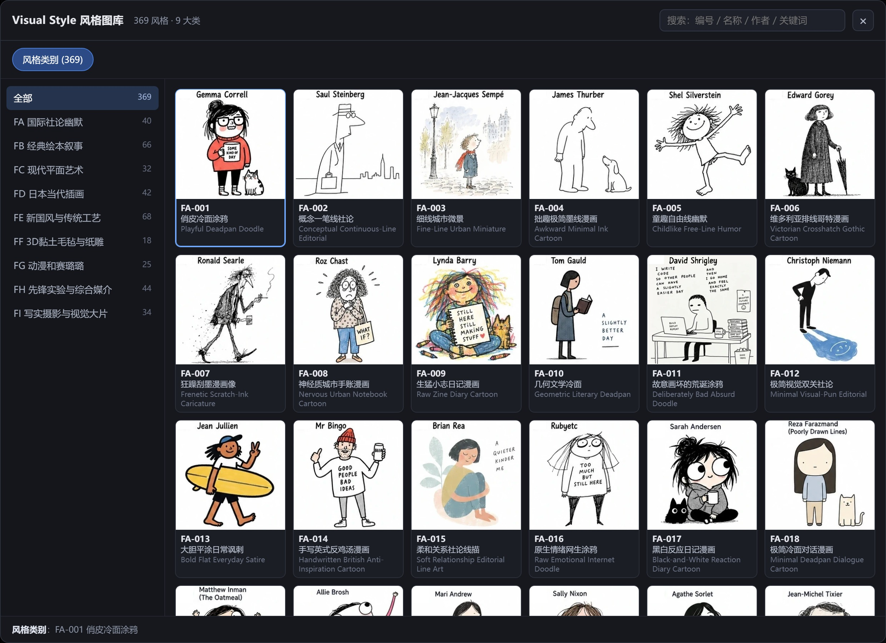
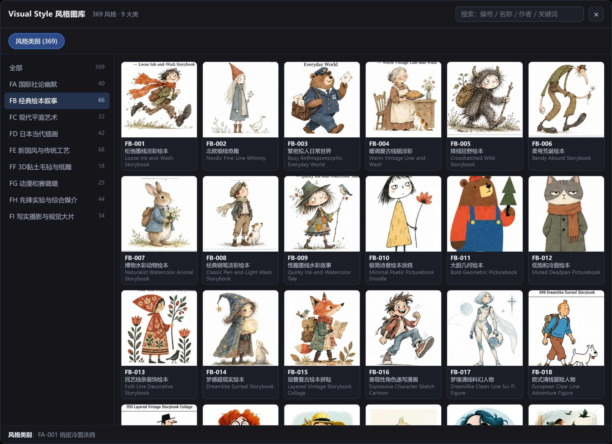
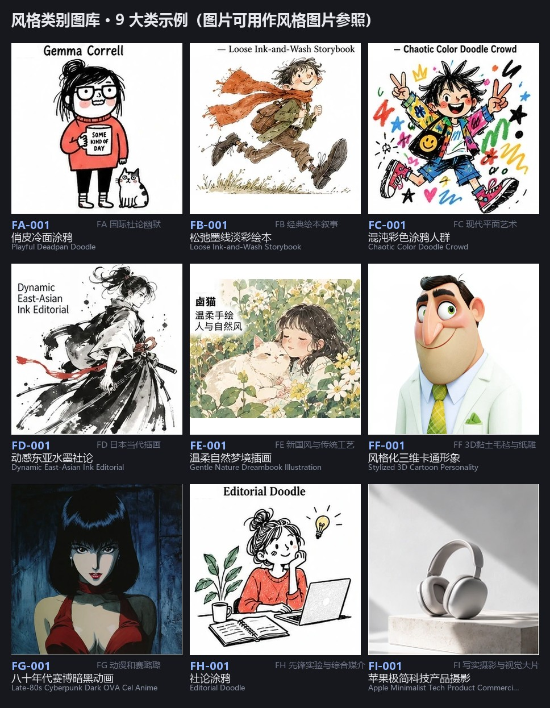

# comfyui-Visual Style Node · 风格类别图库

一个 ComfyUI 自定义节点：**369 种视觉风格，分 9 大类**，点开图库按分类挑一张，节点同时给你两样东西——

- 🖼️ **`image`（图片）→ 可用作「风格图片参照」**
- 📝 **`prompt`（提示词）→ 可用作「风格描述」**



> 数据与图片来自 [yang0/handraw-style](https://github.com/yang0/handraw-style)，本仓库只做打包与接线，遵循上游 LICENSE（保留作者与原仓库地址）。

---

## 这个节点解决什么问题

写「想要某种画风」时，光靠一句风格名往往不够：
- 你希望模型**看见**这种风格长什么样 → 需要一张参考图；
- 你又希望模型**读懂**这种风格的笔触、配色、气质 → 需要一段文字描述。

这个节点把两件事一起做了。选中一个风格后：

| 输出 | 类型 | 用途 | 典型接法 |
|---|---|---|---|
| `image` | IMAGE | **风格图片参照**：把这张样张作为视觉参考，告诉模型「照这个感觉画」 | 接到 IPAdapter / InstantStyle / Redux / 图生图 / 支持参考图的工作流 |
| `prompt` | STRING | **风格描述**：一段自然语言，说明风格名、参考作者/风格名、核心风格特征，再拼上你写的主题 | 接到 `CLIP Text Encode` / 任意文生图提示词输入 / 大语言模型二次改写 |
| `summary` | STRING | 一行摘要，当前选了哪个风格 | 显示 / 记录用 |

两路可以**单用，也可以一起用**：只用图片走参考图分支，只用文字走提示词分支，两路都接就是「图 + 文」双保险。

---

## 安装

1. 把本仓库克隆 / 下载到 ComfyUI 的 `custom_nodes/` 目录：

   ```bash
   cd ComfyUI/custom_nodes
   git clone https://github.com/mugicha-AI/comfyui-Visual-Style-Node.git
   ```

   （也可以直接下载 ZIP 解压，目录名保持 `comfyui-Visual Style Node`。）

2. **重启 ComfyUI**，然后浏览器 **Ctrl + F5** 强制刷新一次。

无需 `pip install`，没有额外依赖；Python 端只用 ComfyUI 自带的 `torch` / `numpy` / `Pillow`。节点完全离线，数据与图片都随节点内置，不联网、不调外部 API、不占显存。

> 小提示：目录名带空格，但 `pyproject.toml` 里用不含空格的 `ComfyUI-VisualStyleNode` 注册前端静态目录
> （`/extensions/ComfyUI-VisualStyleNode/`）。这是为了让 ComfyUI / aiohttp 能正确提供图库数据，请勿改动该注册名。

---

## 使用方法

1. 在节点列表里添加 **Visual Style 风格类别**（分类 `Visual Style`）。
2. 点节点上的 **「打开图库」**，按左侧 9 大类浏览，或直接用搜索框搜「编号 / 中文名 / 英文名 / 作者 / 关键词」。

   

3. 点任意一张卡片即选中，节点画布上会立刻显示该风格的参考图。
4. 在最下方的 **主题** 输入框里写你要画的内容（例如「秋天的第一杯奶茶」）。
5. 出队，节点输出：
   - `image` = 该风格样张（**风格图片参照**）
   - `prompt` = 「风格名称 + 参考作者/风格名 + 核心风格特征 + 你的主题」（**风格描述**）



**控件说明**

| 控件 | 说明 |
|---|---|
| 主题 `theme` | 你写画面内容，节点负责补风格 |
| `language` | `auto`（按主题语言自动判断）/ `zh` / `en` |
| `include_traits` | 是否把「核心风格特征」写进提示词；知名纯风格可关掉，避免稀释 |
| `style` | 隐藏下拉，由图库界面写入，不用手改 |

### 提示词长什么样

以 `FA-001 俏皮冷面涂鸦`、主题「秋天的第一杯奶茶」为例：

```
风格名称：Playful Deadpan Doodle。参考作者/风格名称：Gemma Correll。
核心风格特征：松散黑线、怪萌人物、少量点色、白底、日常吐槽与尴尬幽默；
人物轮廓优先于细节堆砌。主题：秋天的第一杯奶茶。
```

规则：提示词里**不会出现编号**（`FA-001` 这类只做内部键，写进正文会被生图模型当成画面文字画出来）；含否定词的从句会被剔除；风格特征只描述视觉语言。

### 现成示例工作流

仓库里带了一份最小可用工作流：[`examples/basic_workflow.json`](examples/basic_workflow.json)，
只用到 ComfyUI 核心节点（`PreviewImage` + `PreviewAny`），拖进 ComfyUI 即可看到「图片 / 提示词」两路输出。
把它当作模板，把 `image` 改接到你的参考图分支、`prompt` 改接到你的文本编码器即可。

---

## 示例图片

9 大类各挑 1 张，感受一下风格跨度（这些图片**都可以直接当风格图片参照**使用）：



| 编号 | 大类 | 示例 |
|---|---|---|
| FA | 国际社论幽默 | 俏皮冷面涂鸦 |
| FB | 经典绘本叙事 | 松弛墨线淡彩绘本 |
| FC | 现代平面艺术 | 混沌彩色涂鸦人群 |
| FD | 日本当代插画 | 动感东亚水墨社论 |
| FE | 新国风与传统工艺 | 温柔自然梦境插画 |
| FF | 3D 黏土毛毡与纸雕 | 风格化三维卡通形象 |
| FG | 动漫和赛璐璐 | 八十年代赛博暗黑动画 |
| FH | 先锋实验与综合媒介 | 社论涂鸦 |
| FI | 写实摄影与视觉大片 | 苹果极简科技产品摄影 |

图库里共 369 张，编号 `FA`–`FI`。

---

## 🙏 支持一下 / 我常用的 AI 创作平台

如果这个节点帮到你，欢迎 **点个 Star ⭐**，也欢迎通过下面我推广的链接去玩一玩、支持一下（我这边能拿到一点邀请/推广回馈，用来继续做这类免费节点，感谢各位网友 🙇）：

- 🟣 **RunningHub**（AI 无限画布 & ComfyUI 工作流平台，可在线跑工作流）
  👉 https://www.runninghub.ai/?inviteCode=rh-v1603
- 🔵 **ZZAI 真真AI**（AI 画布 Agent、视频 / 图片生成、提示词画廊）
  👉 https://www.zzai.app/?aff=bFpY

平时我也把节点说明、工作流、提示词整理在这份**飞书共享文档**里，持续更新，欢迎收藏：

- 📄 **飞书共享文档**：https://ncnsh7660uxn.feishu.cn/wiki/IVlpwsRVMi7HKOkm3GScf1XRnpd?from=from_copylink

有问题、想要更多风格或发现 bug，欢迎开 Issue / PR，谢谢支持！

---

## 许可与致谢

- 视觉数据与图片来自 **yang0/handraw-style**：https://github.com/yang0/handraw-style ，遵循其 LICENSE：
  可自由使用、修改与商业化，**请保留作者 yang0 与原仓库地址**。
- 本仓库是打包与接线，不修改上游的视觉数据。
